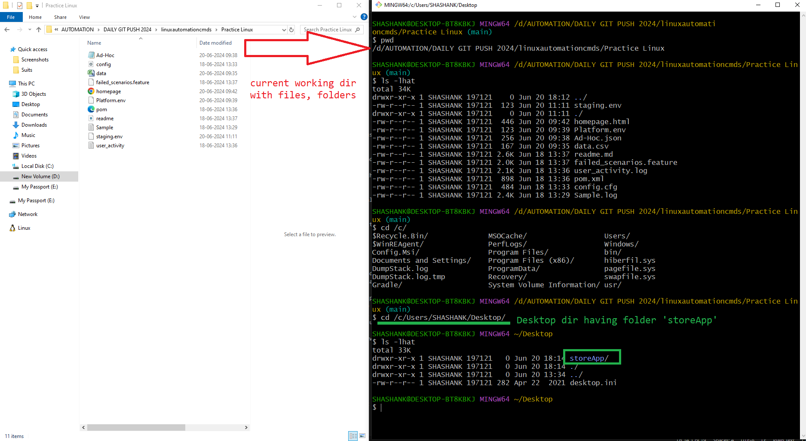
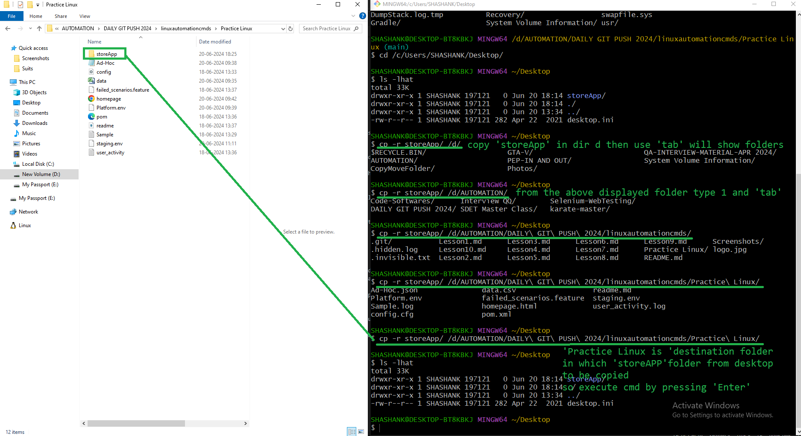
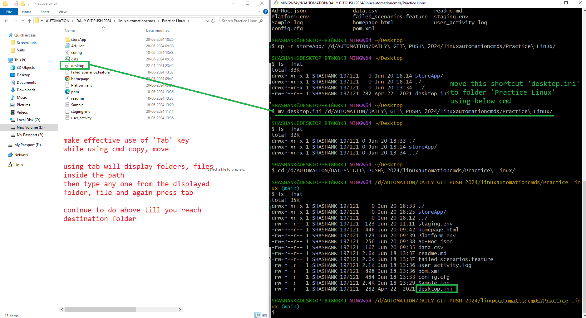
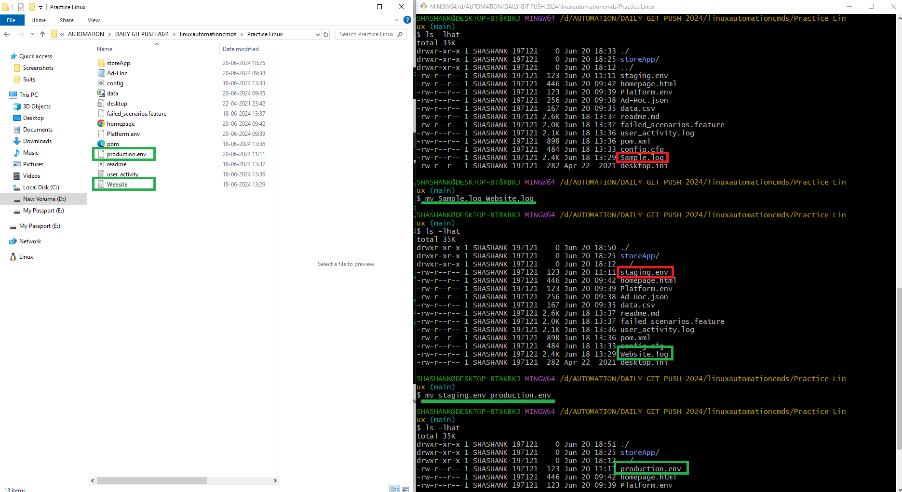

## Copy, move, rename - files, folders

*make effective use of 'Tab' key - while executing cmd copy, move*

*using tab will display folders, files inside the path then type any one from the displayed folder, file and again press tab*

*contnue to do above till you reach destination folder and then execute cmd using 'Enter'*

1. to copy use cmd 'cp -r folderToBeCopied destinationPath'

2. to move use cmd 'mv folderToBeMoved destinationPath'

*for files same cmd to be used*

3. Rename cmd does not exist so will effectively use move cmd to rename
 - 'mv folder renamedFolder'
 - 'mv file renamedFile'

---
Reference screenshots:

---