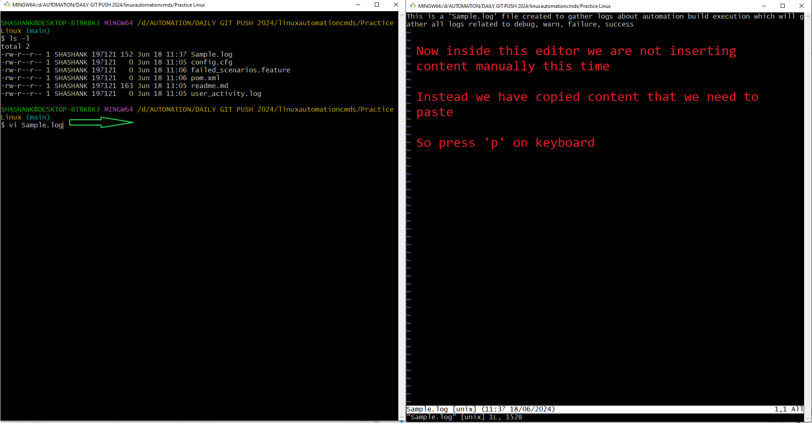
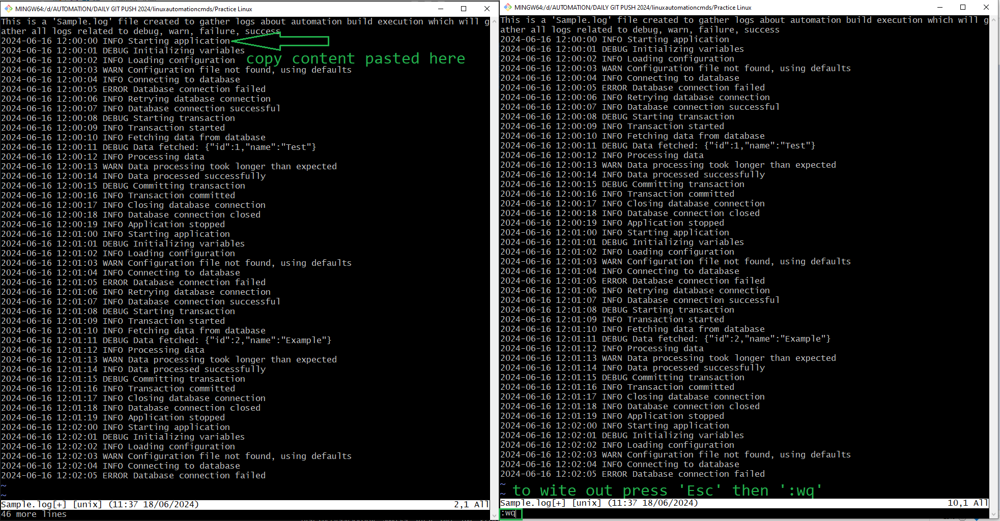
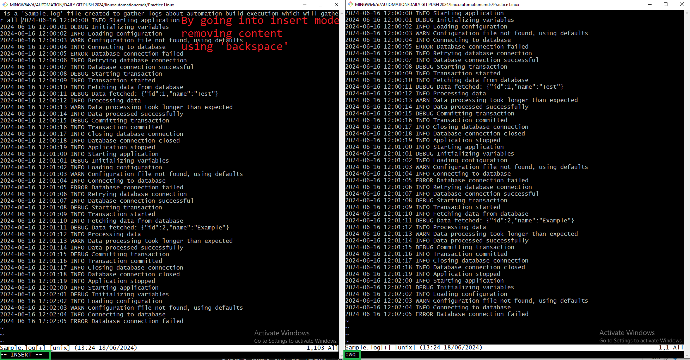
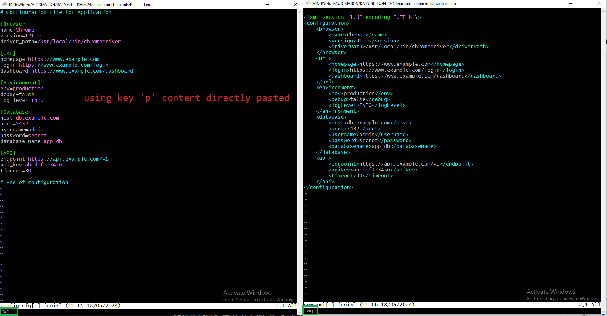

*Lesson2 continue...*

## Pre-requisite:
- Before we learn further commands let's first add dummy content to all previous files created in [Lesson2](Lesson2.md) 
- Using chatgpt I have generated and copied dummy content to all these files
- To paste in vi editor instead using INSERT mode we need to directly paste content using key 'p' 
- Then use ':wq' to write out the pasted content and quit the editor

*(You try these steps yourself and if any issue then refer screenshot)*

---
Reference screenshots:

- Further, I have removed those first 2 lines by going into INSERT mode for Sample.log as well as Readme.md file and have also added content in other files.

---
