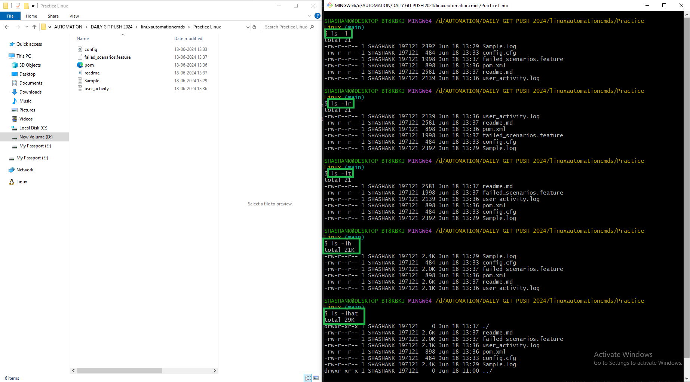

## list and it's attribute commands

```bash
  ls -lhat
  ls -l
  ls -lh
  ls -la
  ls -lt
  ls -lr
```
1. ls -l: returns list of files and folders inside current path

2. ls -lh: above #1 output with human readable output (like file size)

3. ls -la: above #1 output with hidden files

4. ls -lt: above #1 output sorted based on last modified

5. ls -lr: above #1 output sorted in reverse order

6. ls -lhat: execute and check yourself happy testing :)

---
Reference screenshots:

---
