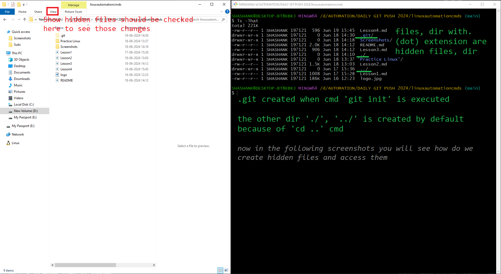
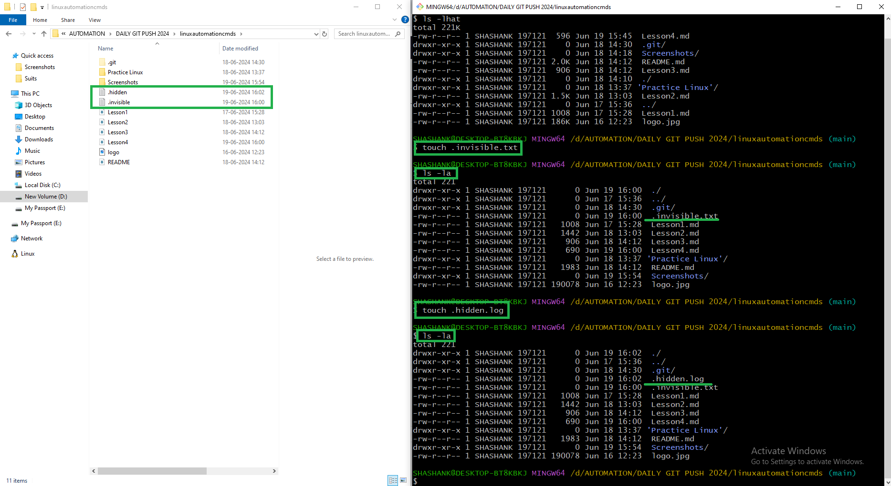

## Creating and accessing hidden files

1. .(dot) extension create hidden files

2. To access them use 'ls -la'

3. When used 'ls -lhat' OR 'ls -la -lh -lt' it is a combination of 'list of files/ dir including hidden one's in human readable format sorted on the basis of last modified'

*P.S. Do add content inside these files, if you don't know how to do this then please learn and practise from [Lesson2](Lesson2.md) [Lesson3](Lesson3.md)*

---
Reference screenshots:

---