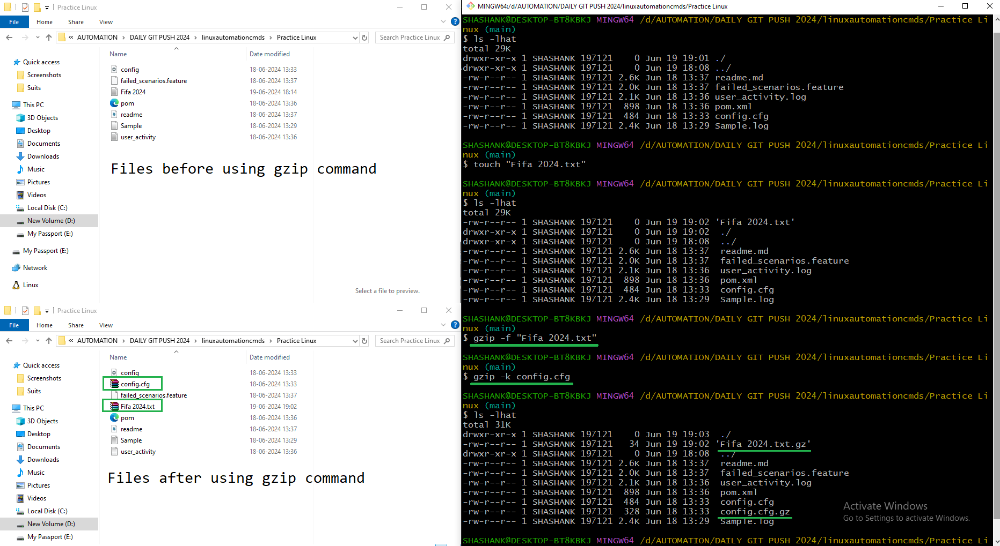
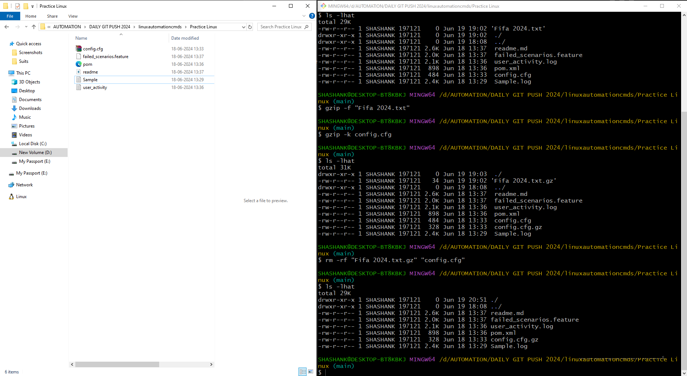

## Creating zip files and removing files

1. When executed a cmd 'gzip -f file' then file is converted to .zip
e.g. gzip -f "Fifa 2024.txt" then .txt file will be converted to 'Fifa 2024'

2. When executed a cmd 'gzip -k file' then original file will remain as it is a new copy of file with .zip extension is generated

*(to unzip the file execute cmd 'gzip-d filename')*

3. To remove will execute cmd 'rm -rf file' or 'rm -f file'
In above cmd it is forced and recursive action taken to delete the file.
---
Reference screenshots:

---