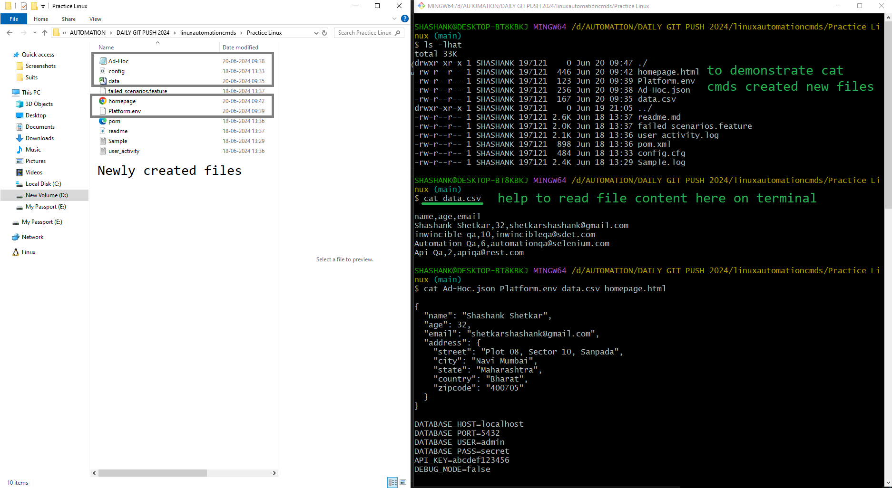
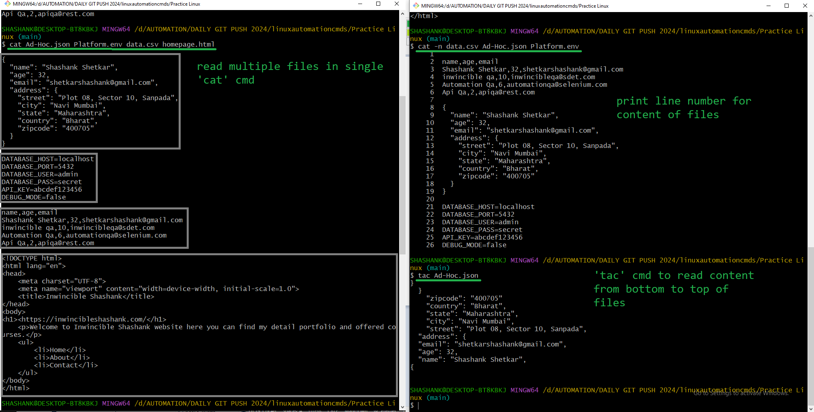
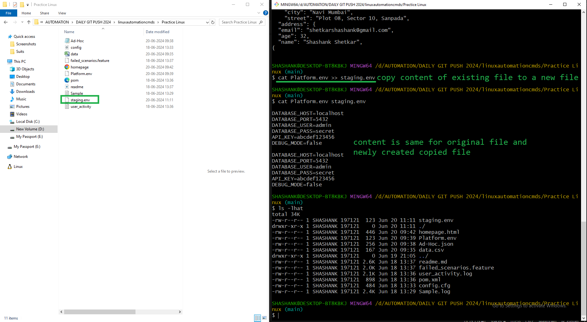

## Read and copy content of files

*Please note in order to demonstrate further cmds I have created new files (homepage.html, Platform.env, Ad-Hoc.json, data.csv) using touch command and added content using vi editor*

1. To read single file 'cat filename'

2. To read multiple files 'cat file1 file2 "file 3'

3. To print line number for content in files 'cat -n file1 "file 2" file3'

4. To print content in reverse 'tac file'
*(try executing all above cmds using 'tac')*

5. To copy content of 1 file to other file 'cat file >> copyFile'
---
Reference screenshots:

---