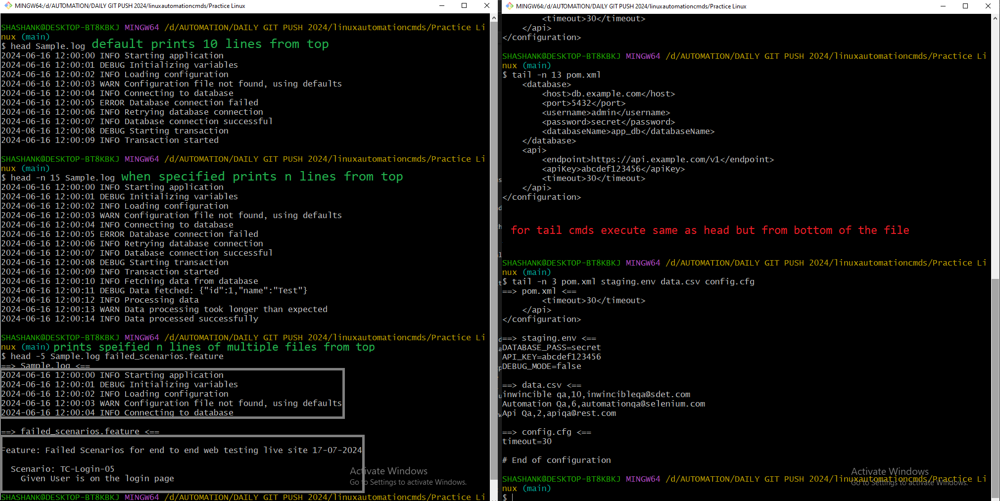

## Display content using head/ tail

1. When used 'head' cmd it prints lines from top whereas when used 'tail' cmd it prints content from bottom

2. 'head file': default it prints top 10 lines

3. 'head -n 15 file': prints 15 lines from top

4. 'head -n 5 file1 file2 "file 3" file4': prints 5 lines for each file

*P.S. replace 'tail' with 'head' and see yourself how content is displayed for tail commands*

---
Reference screenshots:

---