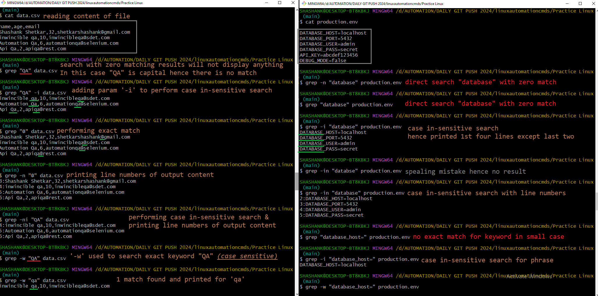
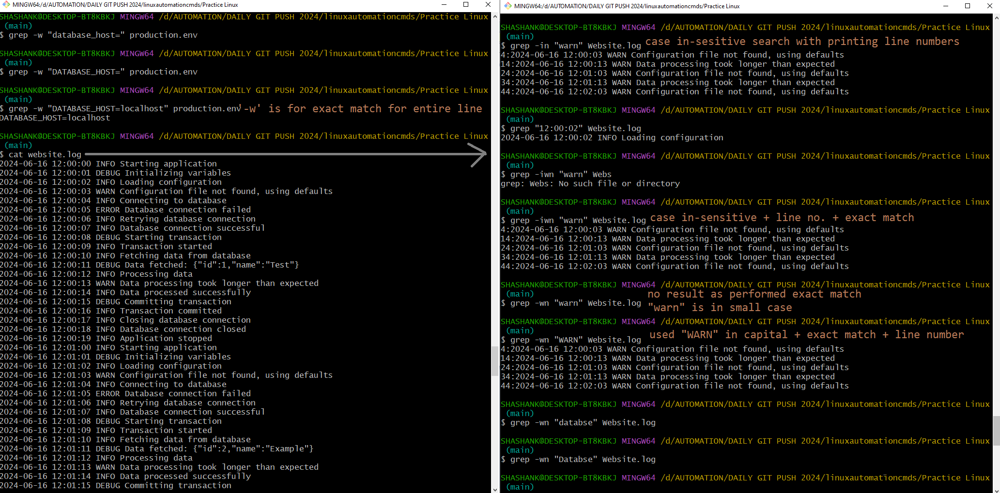
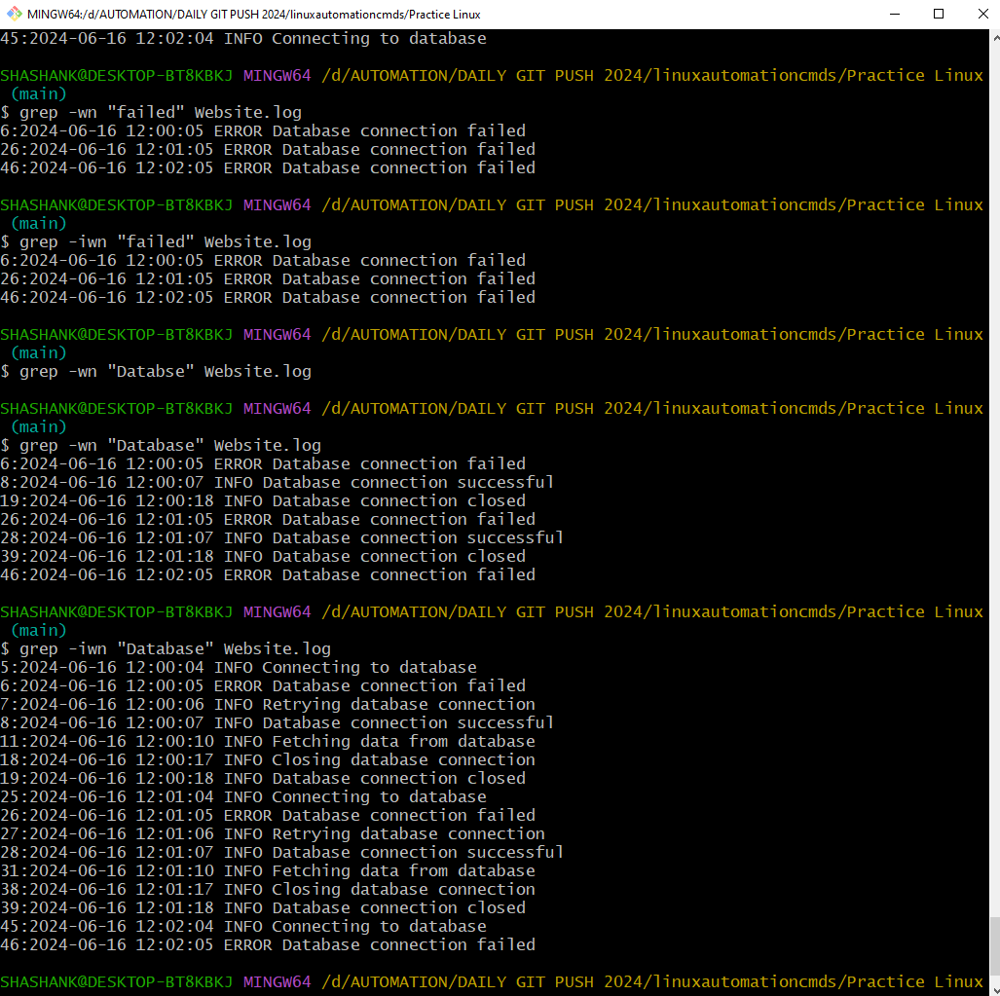
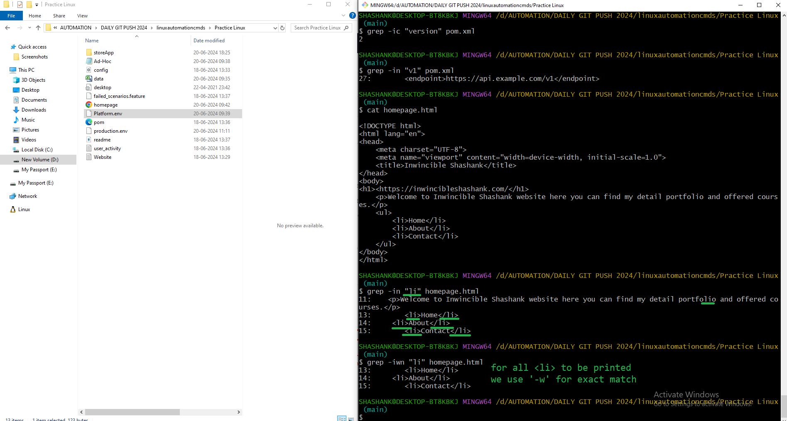

## Search using 'grep'

grep (global regular expression print) - used to search a keyword or pharse inside a file

| grep command               | cmd output                                  |
|----------------------------|---------------------------------------------|
| `grep "ERROR" log.txt`     | Finds and displays all lines containing "ERROR" in log.txt |
| `grep -i "error" log.txt`  | Case-insensitive search for "error" in log.txt |
| `grep -w "ERROR" log.txt`  | Exact search for "ERROR" in log.txt |
| `grep -n "WARN" log.txt`   | Displays lines containing "WARN" with line numbers |
| `grep -c "DEBUG" log.txt`  | Counts the number of lines containing "DEBUG" |

#### Do try lots of combinations for single, multiple files using '-i', '-w', '-n', '-c' and '-inc', '-iwc', etc. Also without any param like., `grep "ERROR" log.txt` ####

---
Reference screenshots:

---