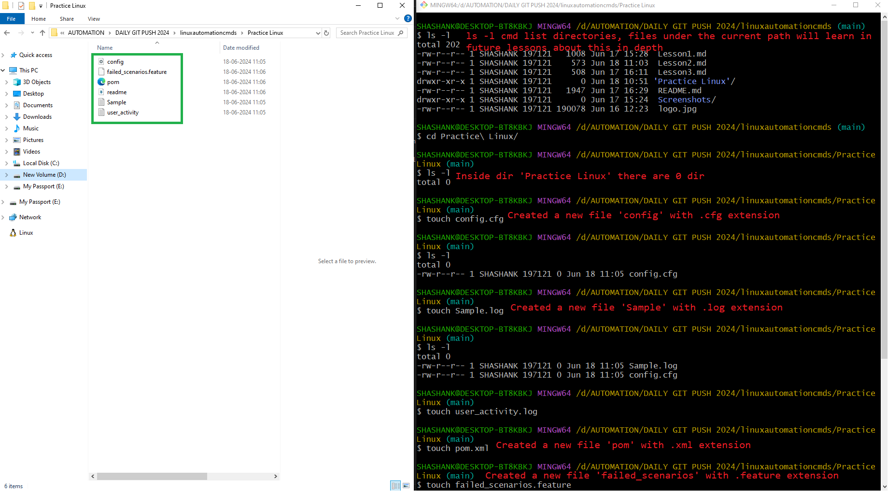
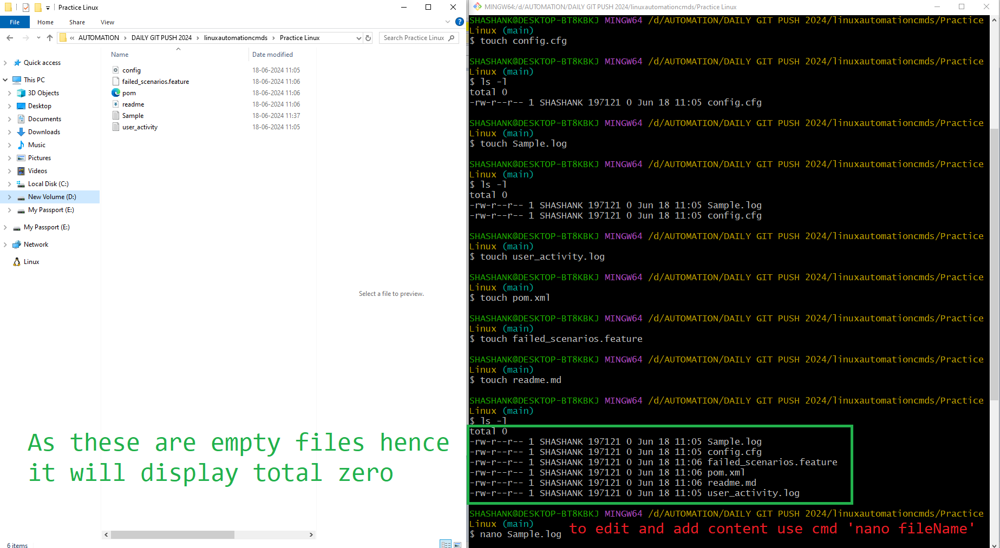
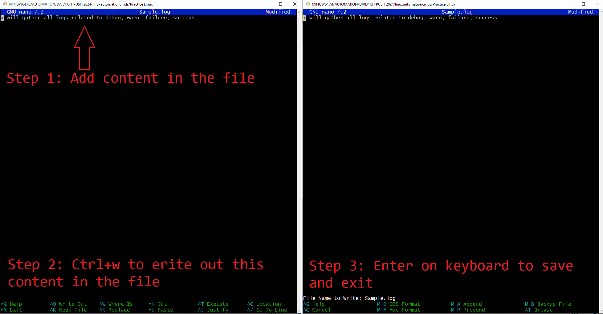
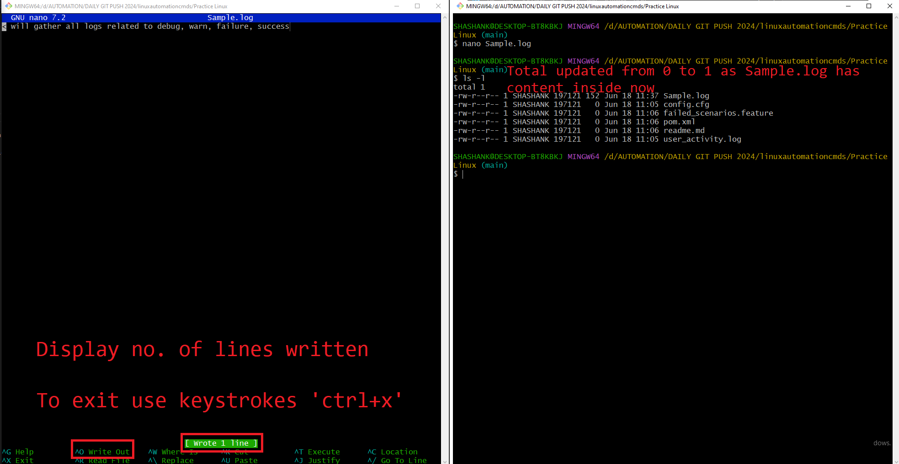
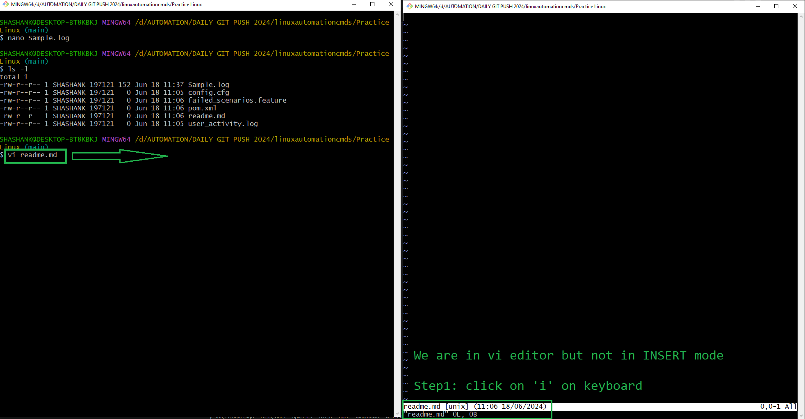
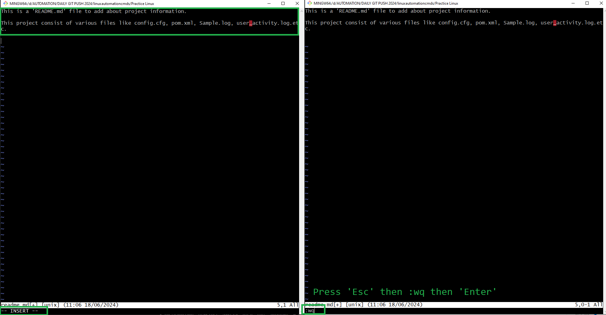

## Create files and terminal editors 

```bash
  touch config.cfg
  touch Sample.log
  touch user_activity.log
  touch pom.xml
  touch failed_scenarios.feature
  touch readme.md
```
## Create file:
1. touch cmd is used to create a new text based file

2. Ensure to add valid file name and extension while creating it

3. '.txt', '.md', '.feature', '.log', '.xml' 
(rest try userself but ensure it to be a text based file only '.doc','.ppt','.csv' wont work will need respective base platform to edit)

## Edit file using nano editor:
```bash
 nano Sample.log
```
1. It will open nano editor to add content simple type
2. To write out content click 'ctrl+w' then to save and confirm click 'Enter'
3. To exit click 'ctrl+x'
4. You will be back on terminal

## Edit file using vi editor:
```bash
 vi Sample.log
```
1. It will open vi editor but we cannot directly write
2. Click 'i' on keyboard to go into INSERT mode
3. Cursor will blink and you can start writting
4. To exit the vi terminal use 'Esc' on keyboard
5. Press ':wq' on keyboard to write out and exit  

---
Reference screenshots:







---