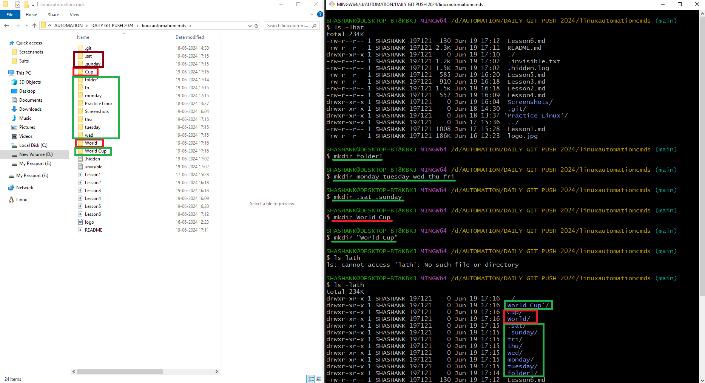
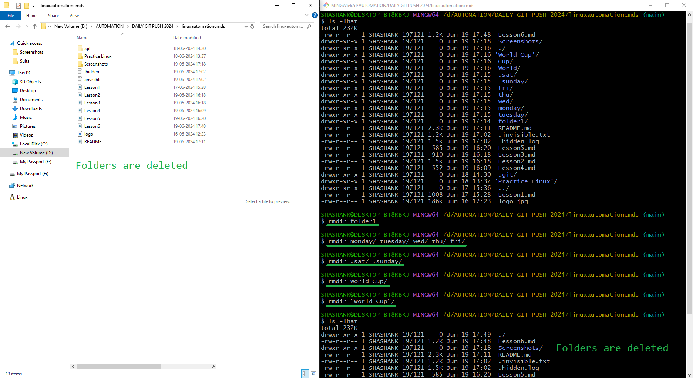

## Creating and removing folders

1. mkdir cmd is used to create a new folder
e.g. mkdir folder1

2. to create multiple folder seperate with space
e.g. mkdir monday tuesday wed thu fri

3. to create hidden folder use .(dot) extension
e.g. mkdir .sat .sunday

4. to create a folder with space use double quotes
e.g. mkdir "World Cup"

*(if you use cmd mkdir world cup then it will create 2 seperate folders)*

5. Create below folders in single cmd to practise more:
    - Ind
    - WI
    - Aus
    - ICC
    - Premier League
    - FIFA club world cup
    - 2024-Champions League

---
Reference screenshots:

---

1. rmdir cmd is used to remove a existing folder
rmdir folder1

2. to delete multiple folder seperate with space
e.g. rmdir monday tuesday wed thu fri

3. to remove hidden folder use .(dot) extension
e.g. rmdir .sat .sunday

4. to delete a folder with space use double quotes
e.g. rmdir "World Cup"

5. Delete the folders created above in [point #5](#point5)

---
Reference screenshots:

---