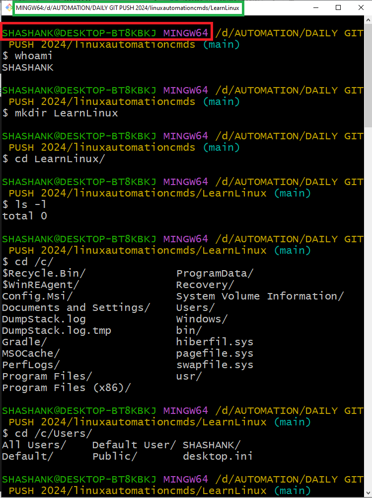
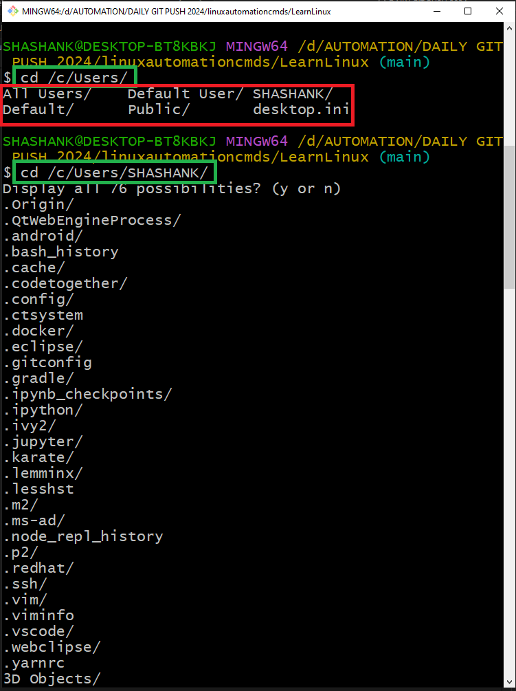
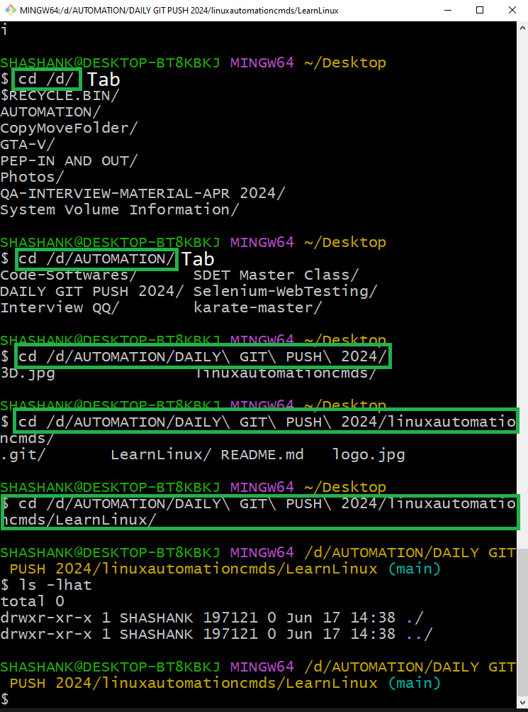

## Basic Commands

```bash
  whoami
  cd directoryPath
  cd ..
  cd partialPath(use of Tab key)
  ls -l
```
1. whoami: returns the user name with wihich you are logged in the computer/laptop

2. cd directoryPath: used to naviagte to desired path of the system

3. cd .. change path to current path-1

4. cd partialPath: with use of tab ket when typed intials it will list possible directories and files user can navigate too

5. ls -l: list all folders and files present in the current folder

---
For below screenshot:
- SHASHANK - Current active user
- @Desktop-BT8KBKJ - Computer/laptop name (Go to about section of windows)
- MINGW64 - Indicates you are in the 64-bit MinGW shell environment
- /d/AUTOMATION/DAILY GIT PUSH 2024/linuxautomationcmds: current user path
- (main) - curent active branch (refer Git repo to understand this)

 


