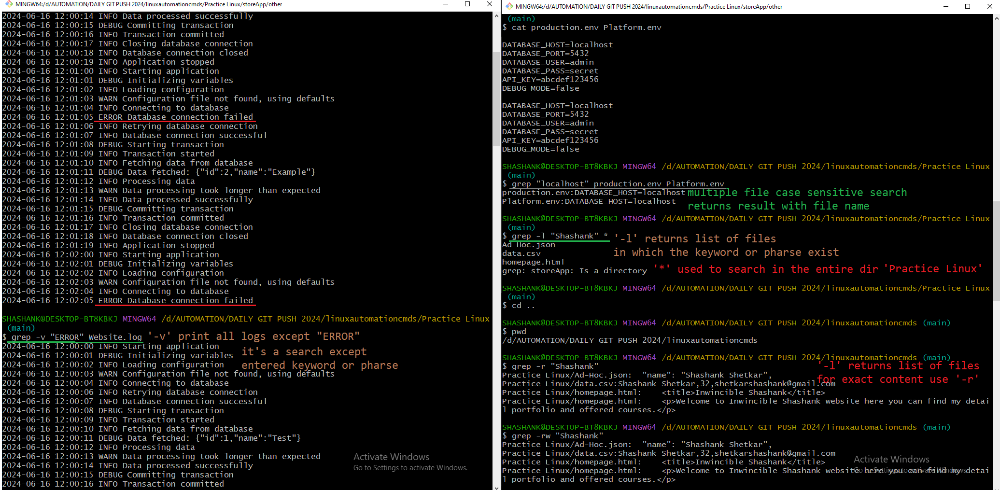

*Lesson11 continue...*
## Search using 'grep'

| grep command               | cmd output                                  |
|----------------------------|---------------------------------------------|
| `grep -v "INFO" log.txt`   | Displays all lines except those containing "INFO" |
| `grep "pattern" file1 file2`| Searches for "pattern" in multiple files (file1 and file2) |
| `grep -r "TODO" .`         | Recursively searches for "TODO" in the current directory and its subdirectories |
| `grep -l "FIXME" *`        | Lists filenames containing "FIXME" in the current directory |

---
Reference screenshots:

---