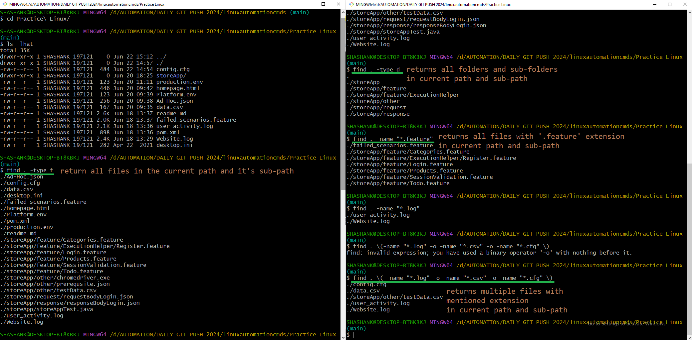

## Search using 'find'

- find - used to search a folder or a file
- '*' is wildcard search
- 'd' for directory and 'f' for file

| find command               | cmd output                                  |
|----------------------------|---------------------------------------------|
| `find . -type d` | Return all dir inside current path |
| `find . -type f` | Return all files inside current path |
| `find . -name "*.extension"` | Return all files with .extension inside current path |

*try finding multiple extension files using cmd `find . -name "*.extension"`*

---
Reference screenshots:

---