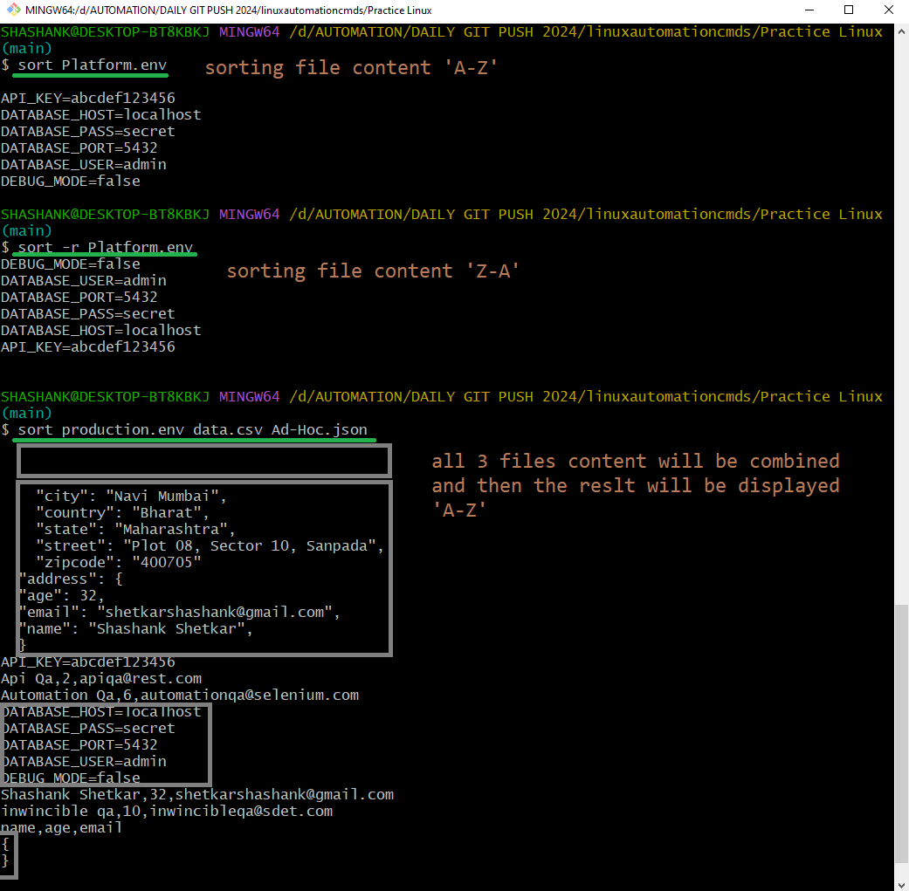

## sorting file contents

| grep command               | cmd output                                  |
|----------------------------|---------------------------------------------|
| `sort user_activity.log` | sorted content A-Z *(in this case sorted based on Date-time stamp)* |
| `sort -r user_activity.log` | sorted content Z-A *(in this case sorted based on date-time stamp)* |
| `sort ` | sorted content A-Z for multiple files |

---
Reference screenshots:

---