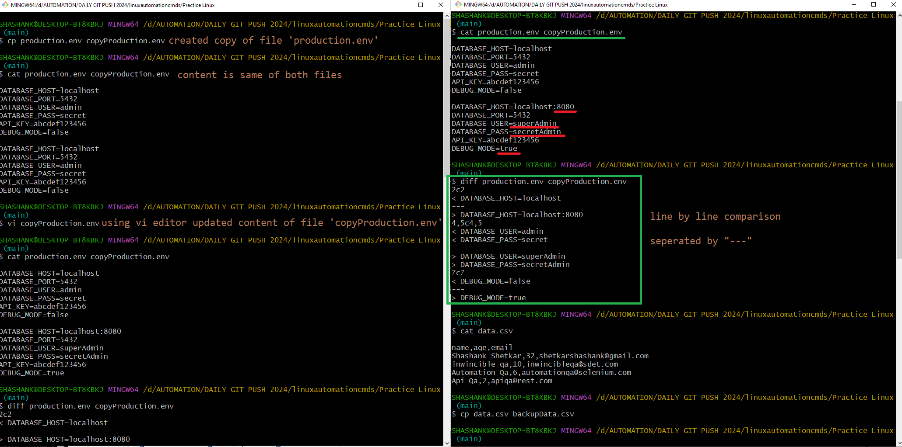
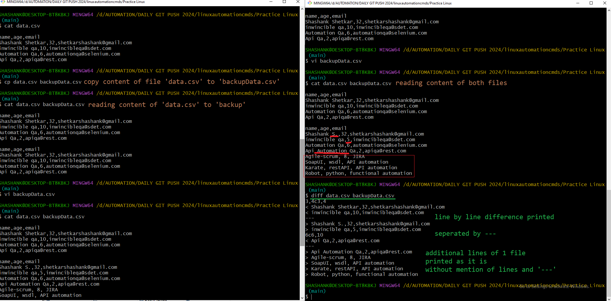

## Compare and Difference

- cmd 'comp' is used for byte by byte comparison
- cmd 'diff' is used to print difference in contents of files

e.g.:
- file.txt: Hello World
- file2.txt: Hello World!
So, the comparison would look like this at the byte level:

| Position | file1.txt Byte | file2.txt Byte |
|----------|----------------|----------------|
| 1        | H              | H              |
| 2        | e              | e              |
| 3        | l              | l              |
| 4        | l              | l              |
| 5        | o              | o              |
| 6        | (space)        | (space)        |
| 7        | W              | W              |
| 8        | o              | o              |
| 9        | r              | r              |
| 10       | l              | l              |
| 11       | d              | d              |
| 12       | \n             | !              |
| 13       |                | \n             |

Here, you can see that at position 12, file1.txt has a newline character (\n), while file2.txt has an exclamation mark (!). This difference makes the files non-identical in a byte-by-byte comparison.

---
| grep command               | cmd output                                  |
|----------------------------|---------------------------------------------|
| `comp file1 file2` | return byte by byte comparison |
| `diff file1 file2` | return difference in content of 2 files |

---
Reference screenshots:

---