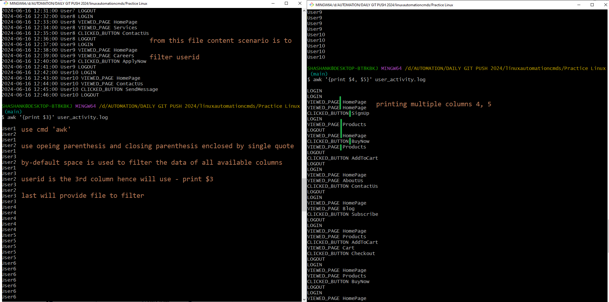
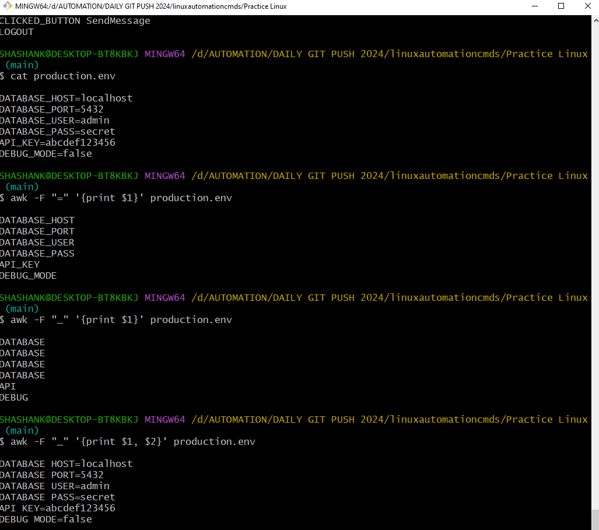

## Filter file content using 'awk' cmd

- use cmd 'awk'
- '-E' is used for extended search
- use opeing parenthesis and closing parenthesis enclosed by single quote
- by-default space is used to filter the data of all available columns
- incase we implicitely want to use any param to filter use that enclosed by double quotes. e.g. "=", "-", ",", "|", etc.
- userid is the 3rd column hence will use - print $3
- last will provide file to filter

| grep command               | cmd output                                  |
|----------------------------|---------------------------------------------|
| `awk '{print $n}' file` | filter content of file basis ' ' (space) and print column n | 
| `awk -F "=" '{print $n1, $n2}' file` | filter content of file basis '=' (equalto) and print (column n1 - before equalto), (column n2 - after equalto) |
| `awk -F "-" '{print $n1, $n2, $n3}' file` | filter content of file basis '-' (hypen) and print (column n1 - before equalto), (column n2 - after equalto) and (column n3 - before/after equalto) |

---
Reference screenshots:

---
